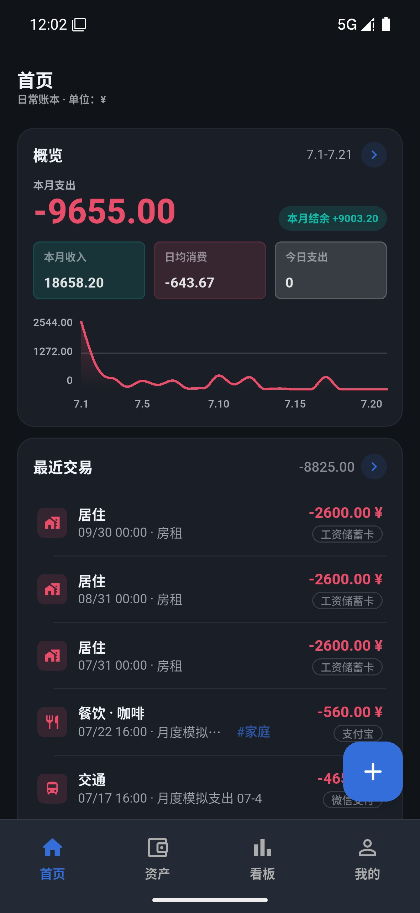
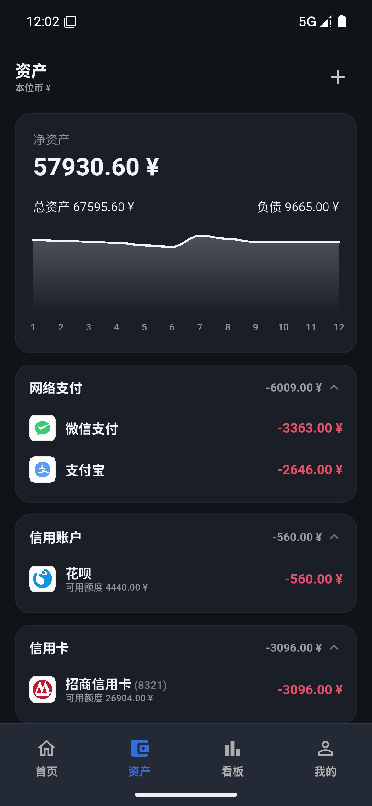
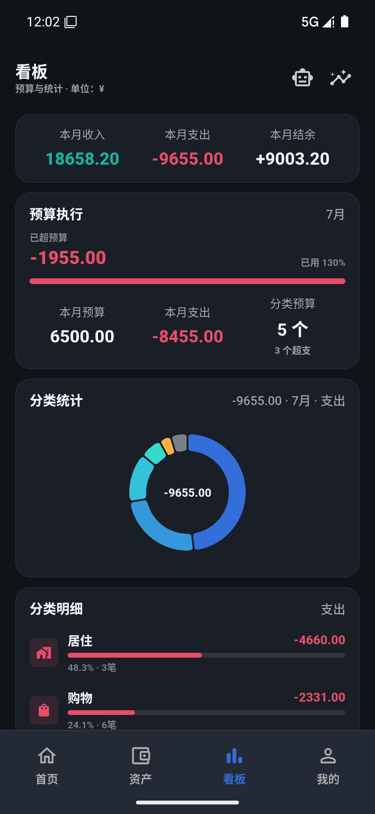

<div align="center">



# Veri Fin

**完全免费 · 本地优先的 Android 记账应用**

[官网](https://verifin.talyra42.top/) · [下载最新版](https://github.com/LumiDesk/verifin/releases) · [产品文档](docs/product/product.md) · [问题反馈](https://github.com/LumiDesk/verifin/issues)

[](https://verifin.talyra42.top/)
[](https://github.com/LumiDesk/verifin/releases)
[](https://github.com/LumiDesk/verifin/stargazers)
[](https://github.com/LumiDesk/verifin/releases)
[](https://github.com/LumiDesk/verifin/issues)
[](LICENSE)

<br />


<br />


</div>

---

> 账本是你的，数据也是。

Veri Fin 是一款仅面向 Android 的个人记账应用。没有账号、没有自有服务端、没有广告，也不接入行为遥测。账本保存在你的设备上；只有你主动使用导出、WebDAV 备份或 AI 功能时，相关数据才会发送到你选择的目标。

## 界面预览

<div align="center">

| 首页 | 资产 | 看板 |
| :---: | :---: | :---: |
|  |  |  |

</div>

## 核心能力

- **快速记账**：支出、收入、转账，支持多级分类、多标签、图片附件、退款和周期记账。
- **账本与资产**：多账本隔离、多币种账户、离线汇率、信用账户、净资产与余额趋势。
- **预算与看板**：总预算、分类预算、按日预算、自定义预算周期，以及日常、月度、年度多维分析。
- **可选 AI**：用自己的 OpenAI 兼容端点记账、查询账目或识别截图；AI 只生成草稿，不会静默写入。
- **数据由你掌控**：账本保存在本地，支持加密备份、WebDAV、账单导入和本应用 CSV 导出。
- **Android 原生体验**：桌面小组件、快捷磁贴、本地提醒、系统分享入口和应用锁。

完整功能、数据口径与当前边界见 [产品文档](docs/product/product.md)，逐项验收标准见 [验收清单](docs/product/acceptance-checklist.md)。

## 技术栈

| 模块 | 技术实现 |
| --- | --- |
| 客户端 | Flutter 3.47.2、Dart 3，仅发布 Android |
| 界面 | Material 3、`fl_chart`、`anchored_menu`，可选液态玻璃底栏 |
| 数据 | SQLite（`sqflite`）、SharedPreferences、分层数据库迁移 |
| 备份与安全 | AES-GCM + PBKDF2、流式 ZIP、WebDAV、Android SAF |
| AI 与 OCR | OpenAI 兼容端点、原生 Tool Calls、端上 ML Kit OCR |
| Android 集成 | Jetpack Glance 小组件、本地通知、快捷磁贴、MethodChannel |

## 下载

可以从 [官网](https://verifin.talyra42.top/) 或 [GitHub Releases](https://github.com/LumiDesk/verifin/releases) 下载 Android 安装包。GitHub 分发版提供 `arm64-v8a` APK。

升级前请先在应用内导出备份，直接覆盖安装，不要卸载应用或清除应用数据。

## 开发

```bash
flutter pub get
flutter run -d <android-device-id> --flavor diagnostic
flutter analyze && flutter test
```

开发环境使用 Flutter 3.47.2、JDK 17+（CI 固定 17）和 Android SDK（含 NDK 与 CMake）。日常调试必须使用独立数据目录的 `diagnostic` flavor；环境自检、真机验收和 release 检查见 [Android 开发](docs/dev/android-development.md)。

正式 APK/AAB 由 CI 构建，本地 APK 不作为交付物。渠道差异、R8 和签名约束以 [技术决策](docs/dev/tech-decisions.md) 与工作流为准。

## 文档

| 文档 | 内容 |
| --- | --- |
| [产品文档](docs/product/product.md) | 产品定位、功能范围与当前边界 |
| [验收清单](docs/product/acceptance-checklist.md) | 当前能力与 Android 验收项 |
| [架构导览](docs/dev/architecture.md) | 分层、源码导航与文档权威顺序 |
| [统一设计](docs/design/design-system.md) | 排版、材质、导航与交互规范 |
| [组件注册表](docs/design/components.md) | 可复用组件、弹窗和纯函数入口 |
| [技术决策](docs/dev/tech-decisions.md) | 数据口径、备份范围与关键技术取舍 |
| [Android 开发](docs/dev/android-development.md) | 工具链、真机调试与交付检查 |
| [贡献指南](CONTRIBUTING.md) | Issue 反馈与仓库维护约定 |

## Star History

<div align="center">

<a href="https://star-history.com/#LumiDesk/verifin&Date">
  
</a>

</div>

## 支持项目

Veri Fin 完全免费，也不通过广告或数据变现。如果它帮到了你，欢迎在 [爱发电](https://afdian.com/a/talyra42) 支持项目；点一个 Star 或提交 Issue，同样很有帮助。

## 许可证

Veri Fin 基于 [GNU General Public License v3.0 or later](LICENSE) 发布。第三方组件和本地 vendor 源码保留各自的许可证。
